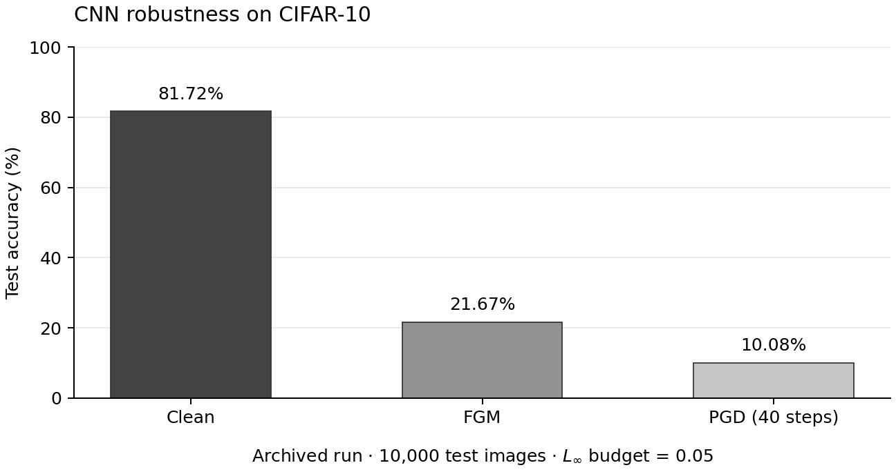

# CNN Adversarial Robustness

An academic project investigating how gradient-based adversarial perturbations affect a CNN trained on CIFAR-10. I trained an image classifier and compared its accuracy on clean inputs, Fast Gradient Method (FGM) inputs and Projected Gradient Descent (PGD) inputs.



## Recorded results

The saved notebook contains a complete evaluation over the **10,000 CIFAR-10 test images**:

| Evaluation | Test accuracy |
| --- | ---: |
| Clean images | **81.72%** |
| FGM, L∞ budget 0.05 | **21.67%** |
| PGD, L∞ budget 0.05, 40 iterations | **10.08%** |

The same classifier was used in all three cases. Images were normalized to `[-1, 1]`; PGD used a step size of `0.01`. These numbers come from the archived notebook outputs, not a new training run during repository preparation. The figure is regenerated directly from those outputs.

## What I worked on

- Built and trained a convolutional classifier with TensorFlow/Keras.
- Prepared CIFAR-10 with spatial augmentation and input normalization.
- Evaluated the effect of one-step and iterative gradient-based attacks using CleverHans.
- Compared clean and adversarial accuracy and examined perturbed image examples.

The experiment demonstrated a large gap between ordinary classification accuracy and performance under the configured perturbations. It evaluated a clean-trained baseline; the recorded run did not use adversarial training.

## Experiment at a glance

| Component | Configuration |
| --- | --- |
| Dataset | CIFAR-10: 50,000 training images, 10,000 test images |
| Model | Three Conv64–Conv128–MaxPool blocks, two Dropout stages, then BatchNorm, Flatten and 10 logits |
| Training | 10 epochs, batch size 128, Adam at 0.001 |
| Loss | Sparse categorical cross-entropy from logits |
| Evaluation batch size | 1,000 |
| Attacks | Untargeted CleverHans FGM and PGD, L∞ budget 0.05 |

The attack calls use the model's predicted labels and do not clip adversarial pixels to the original input range. This matters when interpreting the results. The notebook also omits an explicit training-mode flag in its custom training step; the reproduction runner preserves that call. See [protocol and limitations](docs/protocol.md).

## Reproduce

Use Python 3.12 and the pinned reproduction environment:

```sh
python -m venv .venv
```

Activate it with `.venv\Scripts\Activate.ps1` on Windows or `source .venv/bin/activate` on Linux/macOS, then:

```sh
python -m pip install -r requirements.txt
python src/experiment.py --smoke
```

The smoke check uses two synthetic images and fresh model weights. It checks a training update, finite logits and the perturbation bounds for FGM and 40-step PGD; it does not measure CIFAR-10 accuracy.

To start a new full experiment, which downloads CIFAR-10 and requires substantially more computation:

```sh
python src/experiment.py --epochs 10 --seed 42 --output runs/baseline
```

New checkpoints and metrics are saved under the ignored `runs/` directory. They are separate from the archived results. The original notebook did not save its trained weights or random seed, so an exact numerical replay is not guaranteed.

## Repository guide

- [`notebooks/adversarial_example.ipynb`](notebooks/adversarial_example.ipynb) — original notebook with recorded outputs.
- [`src/experiment.py`](src/experiment.py) — runnable extraction of the model, training and attacks.
- [`results/`](results/) — archived evaluation checkpoints and experiment metadata.
- [`scripts/plot_archived_results.py`](scripts/plot_archived_results.py) — verifies the source and regenerates the CSV and figure.
- [`docs/protocol.md`](docs/protocol.md) — threat model, implementation details and interpretation.
- [`docs/validation.md`](docs/validation.md) — checks performed during portfolio preparation.

## Provenance

**Paul Guillemin** · Mines Saint-Étienne.

This repository presents existing academic work. The original school files were left unchanged. The English documentation, result figure and runnable extraction were added during the portfolio import on 20 October 2026. New commits record their actual dates.

The project uses TensorFlow/Keras, TensorFlow Datasets, CleverHans and CIFAR-10; their respective licenses and terms remain applicable. No repository-wide license has been added.
